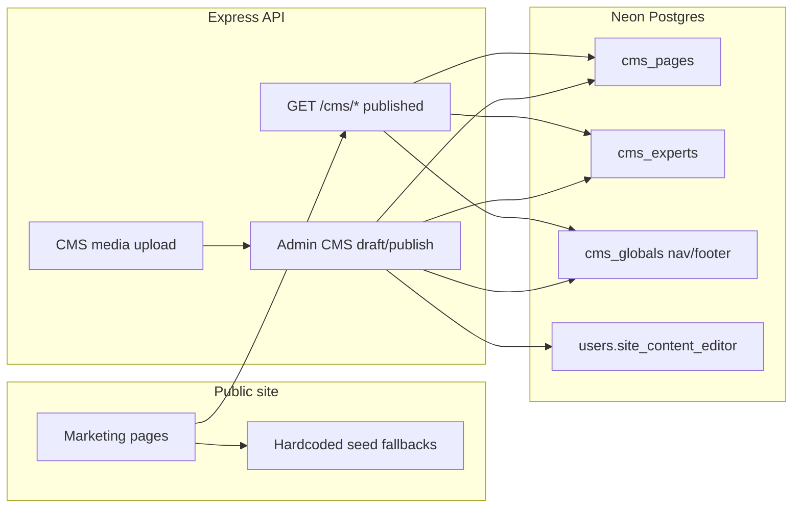

# Site CMS Design

**Date:** 2026-11-15  
**Status:** Approved for implementation planning  
**Scope:** First workstream toward CRM/platform expansion. Public visual redesign, 2FA, full CRM, and fine-grained super-admin matrices are **out of scope**.

## Goal

Turn LEAF-C’s hardcoded marketing content into a draft → preview → publish CMS so authorized users can edit page sections (text and images), create sections from a fixed catalog, manage experts (including order), and edit nav and footer—with toast feedback for success and errors.

## Decisions locked

| Topic | Choice |
|-------|--------|
| Editing UX | Hybrid: dashboard for nav/footer/experts; page editor (+ light preview entry) for sections |
| Publish model | Draft → Preview → Publish |
| Page coverage | All public marketing pages: `/`, `/about`, `/experts`, `/consultancy`, `/operations`, `/training`, `/polygraph` |
| Section creation | Fixed catalog of section types |
| Access | Admin grants a single **Site content editor** capability; admins always have it |
| Architecture | Page document CMS (JSON typed sections) plus separate experts / nav / footer resources |

## Current baseline

- Next.js 16 static export (`output: "export"`) + Express/Drizzle/Neon.
- Partial CMS exists for insights, academy courses, and division page JSON (`division_pages`) with hardcoded frontend fallbacks.
- Home hero, home sections, nav, footer, and experts are hardcoded (`HomeHero`, `page.tsx`, `lib/nav.ts`, `lib/experts.ts`, etc.).
- Auth: JWT roles `admin` | `senior_agent` | `agent` | `customer`; admin-only dashboard content tools today.
- Uploads: multer → `/uploads/...` (avatars pattern to extend for CMS media).

## Architecture



Public pages **client-fetch** published content at runtime (same pattern as `fetchPublishedDivision` / `lib/content.ts`). Empty or missing API data keeps current hardcoded content as fallback until first publish.

## Data model

### `users`

Add `site_content_editor` boolean, default `false`.  
Effective editor = `role === "admin"` OR `site_content_editor === true`.

### `cms_pages`

| Column | Notes |
|--------|--------|
| `slug` | PK: `home`, `about`, `experts`, `consultancy`, `operations`, `training`, `polygraph` |
| `draft_content` | JSONB section document |
| `published_content` | JSONB section document (nullable until first publish) |
| `updated_by_id` | FK users |
| `published_at` | nullable |
| `created_at` / `updated_at` | timestamps |

**Section document:**

```ts
type PageContent = {
  version: 1;
  sections: Section[];
};

type Section = {
  id: string; // stable uuid
  type: SectionType;
  // type-specific fields; unknown keys stripped on validate
};
```

**Section catalog (v1):**

| Type | Purpose |
|------|---------|
| `hero` | Label, heading, paragraph, media (image/video ref), CTAs |
| `richText` | Label, heading, paragraphs |
| `textImage` | Label, heading, paragraph, image, image position |
| `cardGrid` | Label, heading, paragraph, cards[] (title, body, image, href, accent) |
| `photoCards` | Label, heading, photo cards[] |
| `experts` | Embed experts list (uses `cms_experts` order; optional intro copy) |
| `cta` | Heading, paragraph, button label/href |
| `inquiry` | Service inquiry block intro copy (form itself stays code-owned) |

Existing layouts map onto these types; v1 does not invent a new public visual system—only makes copy/media data-driven.

### `cms_experts`

| Column | Notes |
|--------|--------|
| `id` | serial PK |
| `slug` | unique |
| `name`, `title` | required |
| `photo_url` | nullable |
| `initials`, `portrait` | optional display helpers |
| `summary` and detail JSON | optional bio fields on the published projection (align with current `ExpertProfile`) |
| `draft` | JSONB holding the full editable expert payload (including intended `sort_order` and visibility) |
| `published` | boolean — whether this expert appears in public published lists |
| `sort_order` | integer — **published** order; draft order lives in `draft` until publish |

**Experts publish model:** Experts are a **global resource** with their own draft and published projections so home and `/experts` stay consistent. Reorder + CRUD apply to `draft`; `POST .../publish` copies each expert’s `draft` onto published columns (`name`, `title`, `photo_url`, bio fields, `published`, `sort_order`) in one transaction.

### `cms_globals`

| Column | Notes |
|--------|--------|
| `key` | PK: `nav` \| `footer` |
| `draft_content` | JSONB |
| `published_content` | JSONB |
| `updated_by_id`, `published_at`, timestamps | same as pages |

**Nav content:** ordered items `{ id, label, href, visible }`. Hrefs allowlisted to known app routes or `https://` URLs.

**Footer content:** structured fields for contact (location, phone, email), social links, short blurb/column labels—not freeform HTML.

### Media

Files under `uploads/cms/`. DB may store only URLs inside JSON; optional `cms_media` table is not required for v1.

## Editor UX

### Hub

Route: `/dashboard/site-content`  
Visible when effective site content editor. Tabs/sections: **Pages**, **Experts**, **Navigation**, **Footer**.

### Page editor

- Load draft for slug; if no row, seed draft from hardcoded frontend defaults (or server seed).
- List sections in order; add from catalog; reorder; duplicate; delete.
- Edit fields per type; image upload/replace with thumbnail.
- **Preview:** open public layout with draft payload (`?preview=1`, authenticated draft fetch). Live visitors still see published only.
- **Publish:** copy draft → published in one transaction; success toast.
- Optional entry from preview into the same section form (not a full canvas WYSIWYG in v1).

### Experts

CRUD: photo, name, title/position, bio fields, visibility. Drag-and-drop or up/down for `sort_order` on draft. Publish promotes experts.

### Nav / Footer

Structured forms; draft save; preview in header/footer; publish.

### Permissions UI

Admin-only: list users, toggle **Site content editor**. No per-page grants in v1.

### Toasts

Success and error toasts for save draft, publish, upload, reorder, and permission denials. Field-level errors remain on the form.

## APIs

### Auth

- Include `siteContentEditor` in login/me JWT or user payload (admins forced true).
- Middleware `requireSiteContentEditor`.

### Public

- `GET /cms/pages/:slug` → published page content
- `GET /cms/experts` → published experts in order
- `GET /cms/nav` / `GET /cms/footer` → published globals

### Admin (require site content editor)

- Pages: `GET/PUT /admin/cms/pages/:slug` (draft), `POST /admin/cms/pages/:slug/publish`, `GET /admin/cms/pages/:slug/preview`
- Experts: list/create/update/delete/reorder draft; `POST /admin/cms/experts/publish`
- Globals: `GET/PUT /admin/cms/globals/:key`, `POST /admin/cms/globals/:key/publish`
- Media: `POST /admin/cms/media`
- Admin-only: `GET /admin/users`, `PATCH /admin/users/:id` with `{ siteContentEditor: boolean }`

### Validation

Server-side schemas per section type (Zod or equivalent). Reject unknown section types; strip unknown keys; validate image URLs; validate nav hrefs. Publish is atomic per resource (no partial publish).

## Frontend integration

- Extend `frontend/lib/content.ts` (or sibling module) with CMS fetch helpers.
- Marketing pages compose from published sections via shared section renderers.
- Keep hardcoded modules as **seed/fallback** until published content exists.
- Dashboard nav: add Site Content for editors; Users/grants for admins.
- Division admin page content may later migrate into `cms_pages`; v1 can either (a) replace `division_pages` usage for those four slugs with `cms_pages`, or (b) dual-read with `cms_pages` as source of truth after migration. **Decision: `cms_pages` becomes source of truth for those slugs; migrate existing `division_pages` rows into `cms_pages` on deploy, then stop writing `division_pages`.**

## Errors and rollback

- 400 validation, 401/403 auth, upload type/size errors with clear messages.
- v1 rollback = edit draft back to last good content and republish. No full version history in v1.

## Testing

- Backend: section validation; publish copies draft → published; editor grant allows access; non-editor gets 403; admin can grant/revoke.
- Smoke: edit home hero → preview differs from live → publish updates live; reorder experts; rename nav item; edit footer; revoke capability → 403.

## Out of scope

- Full public site visual redesign / new design system
- 2FA / MFA
- Super-admin permission matrix beyond `site_content_editor`
- CRM case/pipeline product expansion
- Freeform HTML sections or arbitrary block trees
- Per-page permission grants
- Published content version history / one-click rollback to N−1

## Success criteria

1. Editors can change hero/section labels, headings, paragraphs, and card images on all listed marketing pages via draft → preview → publish.
2. Editors can add/remove/reorder catalog sections on a page.
3. Experts can be added/edited/reordered and shown consistently where the experts section is used.
4. Nav labels/targets/visibility and footer fields are editable with the same publish flow.
5. Admin can grant/revoke Site content editor; without it, CMS admin APIs and UI are unavailable.
6. Public site remains usable offline-of-CMS via hardcoded fallbacks when nothing is published yet.
)
